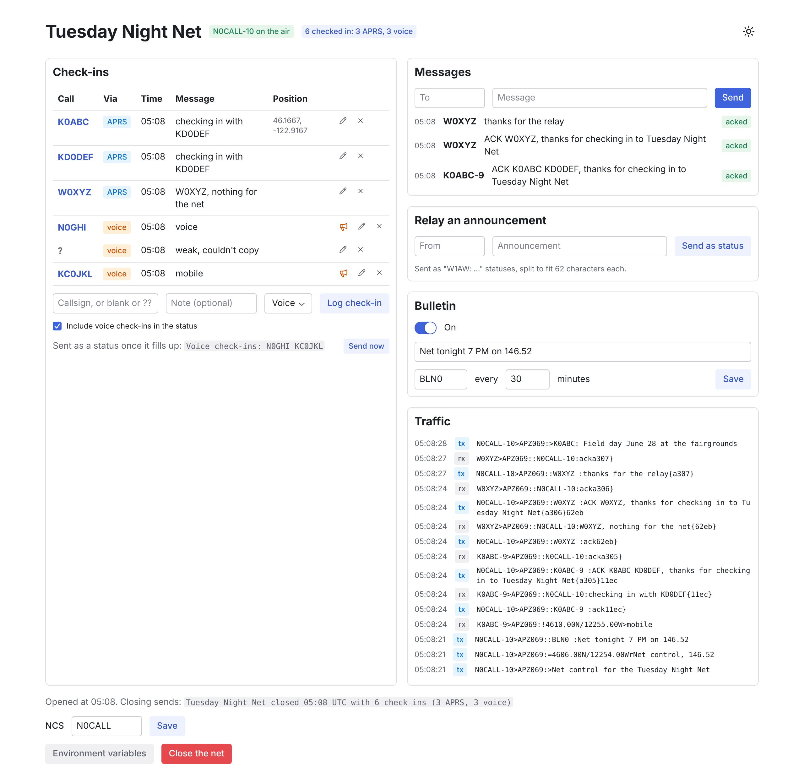
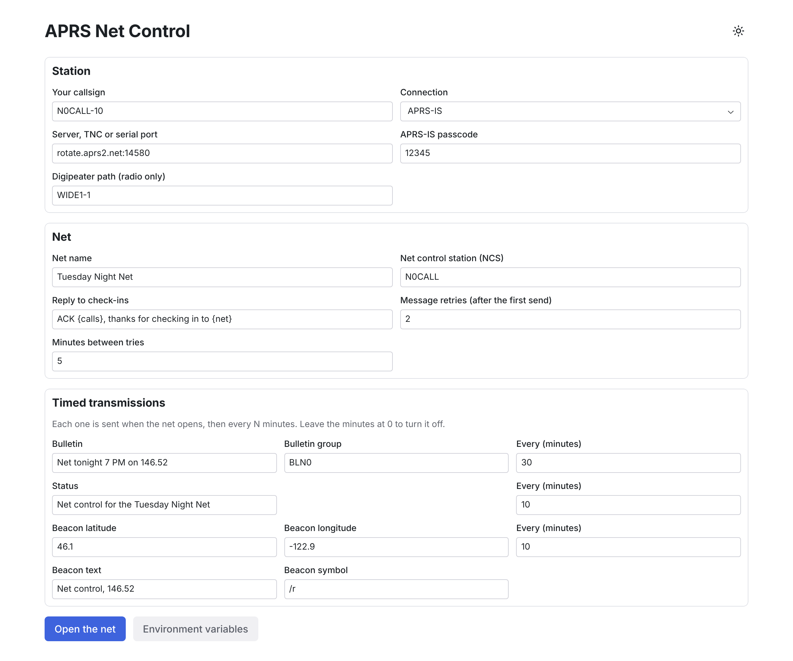

# APRS Net Control

A web app for running an APRS net, built with [Reflex](https://reflex.dev) on
`base-aprs-client`.



Stations check in by sending any APRS message to net control. Each new
station gets one reply ("ACK N0CALL, thanks for checking in to Tuesday Night
Net"). A check-in that names other callsigns ("checking in with N7DEM") logs
those stations too. From the page you can:

* watch check-ins arrive, with each station's last position when it beacons
* log check-ins by hand, as voice or APRS (counted separately). Voice
  check-ins are announced in a status ("Voice check-ins: W1AW N7DEM ..."),
  sent once when it fills APRS's 62-character status limit, or when you
  press Send now or close the net. Leave the callsign blank, or type `??`,
  for a station you couldn't copy: it's logged but never announced. The
  megaphone on each row leaves a station out of the status
* edit or remove check-ins, and record the net control station (NCS)
* relay an announcement from a station as a status ("W1AW: ...")
* send messages, see when they're acked, and cancel one still sending. Unacked messages are resent
  gently: 3 tries, 5 minutes apart, by default (both settable)
* send a bulletin, status and position beacon (with its own text) when the net opens and then on
  a timer. The bulletin can be changed, and switched off and on, while the
  net runs
* see every packet heard and sent
* close the net, which sends a summary status with the end time in the
  server's time zone ("Tuesday Night Net closed 20:15 PST with 12
  check-ins"), and download the check-ins as CSV

Each browser keeps a copy of the net's settings and check-ins in
localStorage. If the server stops mid-net, restart it and the page offers to
reopen the net with the saved check-ins.

It connects to APRS-IS, a KISS TNC on TCP (Dire Wolf listens on
`localhost:8001`), or a serial KISS TNC.

## Running it

The app is its own [uv](https://docs.astral.sh/uv/) project, with its
dependencies locked in `uv.lock` and `base-aprs-client` installed from this
checkout:

```
cd examples/aprs_net
uv run reflex run
```

The first run creates `.venv` and builds the frontend, which takes a minute.

Then open http://localhost:3000, enter your callsign and connection, and
open the net. To transmit through APRS-IS you need the passcode for your
callsign. With `-1` the net can hear check-ins but its replies are dropped by
the server.



Each browser remembers the settings of the last net it opened and fills
them in next time. To fill in the form ahead of time on any browser, set
`APRS_NET_*` environment variables, one per form field: `APRS_NET_CALL`,
`APRS_NET_CONNECTION` (`aprsis`, `kiss_tcp` or `kiss_serial`),
`APRS_NET_ADDRESS`, `APRS_NET_PASSCODE`, `APRS_NET_NAME`,
`APRS_NET_BEACON_COMMENT` and so on. The **Environment variables** button
shows the current settings as `export` lines to copy. Settings remembered by
the browser take precedence over the environment.

### Trying it without a radio

Run the local APRS-IS relay, and point the app at it:

```
uv run python -m base_aprs_client.simulator &
APRS_NET_CALL=N0CALL-10 APRS_NET_ADDRESS=localhost:14588 uv run reflex run
```

Then check in from another terminal with the chat example:

```
uv run python ../chat.py --call N0CALL-1 --to N0CALL-10 --aprsis localhost:14588
```

## How it's put together

* `aprs_net/net.py` has the net logic and no web code: `Net` wraps an
  `AsyncClient`, answers check-ins, runs the timers, and counts changes in
  `version`. `tests/test_aprs_net.py` tests it against the simulator.
* `aprs_net/state.py` is the Reflex state. The one `Net` lives at module
  level, since the server is one radio station shared by every open page.
  Each page polls it once a second and copies it into its state when
  `version` changes. Run the backend with a single worker so every page sees
  the same net.
* `aprs_net/aprs_net.py` is the page.
